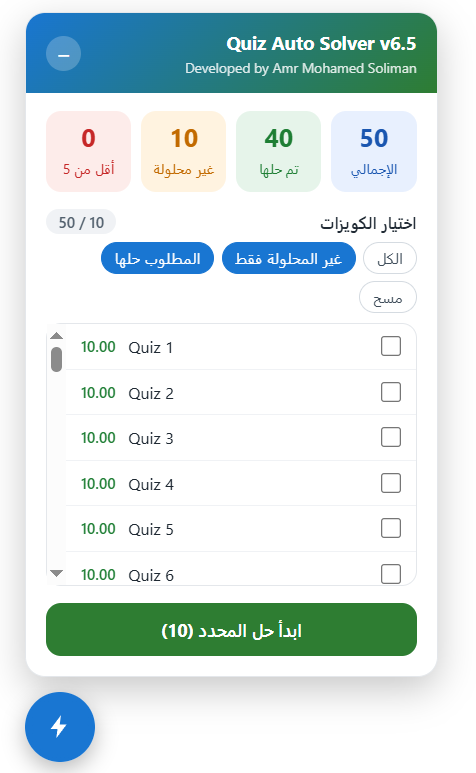

<h1 align="center">Moodle Quiz Auto Runner</h1>

  <b>سكريبت Tampermonkey بيحل كويزات Moodle تلقائياً من صفحة الدرجات، من لوحة تحكم عائمة بسيطة.</b>

  
  
  
  

  <a href="https://raw.githubusercontent.com/amrm3195/Moodle-Quiz-Auto-Runner/main/Moodle-Quiz-Auto-Runner.user.js"><b>تثبيت السكريبت</b></a>
  &nbsp;|&nbsp;
  <a href="#التثبيت">طريقة التثبيت</a>
  &nbsp;|&nbsp;
  <a href="#الاستخدام">الاستخدام</a>
  &nbsp;|&nbsp;
  <a href="#التحديث">التحديث</a>
  &nbsp;|&nbsp;
  <a href="https://github.com/amrm3195/Moodle-Quiz-Auto-Runner/issues">الإبلاغ عن مشكلة</a>

<!-- ضع لقطة شاشة للوحة التحكم هنا، مثلاً: 

 -->

---

## ما هو البرنامج؟

Moodle Quiz Auto Runner سكريبت بيشتغل على منصة Moodle الخاصة بالجامعة (`aunonline.aun.edu.eg`). بيقرا قايمة الكويزات من صفحة الدرجات، وتختار منها اللي عايز تحلها، وهو بيعمل الباقي لوحده.

الفكرة بتقوم على محاولتين لكل كويز:

> المحاولة الأولى (فاضية) ← صفحة المراجعة ← حفظ الإجابات الصحيحة ← المحاولة الثانية ← تعبئة الإجابات المحفوظة ← إنهاء الكويز ← الكويز اللي بعده

## المميزات

- لوحة تحكم عائمة على شكل دايرة تقدر تفتحها وتقفلها في أي وقت، وبتفتكر آخر حالة.
- إحصاء كامل في صفحة الدرجات: الإجمالي، تم حلها، غير محلولة، وأقل من 5.
- عرض كل الكويزات مترتبة، والكويزات اللي درجتها أقل من 5.00 ظاهرة بلون أحمر خفيف لأنها محتاجة تتحل من جديد.
- اختيار الكويزات اللي عايز تحلها بشكل يدوي أو من أزرار الاختيار السريع.
- شريط تقدم (progress bar) بيعرض عدد الكويزات اللي اكتملت، والكويز الحالي، والخطوة اللي فيها.
- زر إيقاف في أي لحظة.
- دعم أسئلة الاختيار الواحد، والاختيار المتعدد (checkbox)، وصح/خطأ (True / False)، والإجابات النصية.
- بعد الانتهاء بيرجعك لصفحة الدرجات تلقائياً ويعرض ملخص بالنتيجة وأي ملاحظات.

## المتطلبات

| المطلوب | التفاصيل |
|---|---|
| المتصفح | Chrome أو Edge أو Firefox |
| الإضافة | [Tampermonkey](https://www.tampermonkey.net/) |
| الموقع | `aunonline.aun.edu.eg` (مسار `med-ns`) |
| اتصال | إنترنت عادي، والسكريبت نفسه ما بيبعت بيانات لأي مكان |

## التثبيت

1. ثبّت إضافة **Tampermonkey** على متصفحك من [الموقع الرسمي](https://www.tampermonkey.net/).
2. افتح رابط السكريبت المباشر:

   [**Moodle-Quiz-Auto-Runner.user.js**](https://raw.githubusercontent.com/amrm3195/Moodle-Quiz-Auto-Runner/main/Moodle-Quiz-Auto-Runner.user.js)

3. هتظهر لك صفحة Tampermonkey، دوس على **Install**.
4. افتح صفحة الدرجات في Moodle وحدّثها. لازم تلاقي الدايرة الزرقاء أسفل الشمال.

> ملاحظة: في بعض إصدارات Chrome الحديثة لازم تفعّل خيار **Allow User Scripts** (أو **Developer mode**) من صفحة إدارة الإضافات `chrome://extensions` لإضافة Tampermonkey، عشان السكريبتات تشتغل.

## الاستخدام

1. ادخل على صفحة الدرجات (User report) الخاصة بالكورس. اللوحة بتظهر لوحدها.
2. راجع الإحصاء فوق، وبعدين اختار الكويزات من القايمة أو من أزرار الاختيار السريع.
3. دوس على زر **ابدأ حل ...**.
4. سيب التبويب مفتوح وراقب شريط التقدم. السكريبت هيتنقل بين صفحات الكويز بنفسه.
5. لو عايز توقف في أي وقت دوس على **إيقاف التشغيل التلقائي**.
6. في الآخر هيرجعك لصفحة الدرجات ويعرض ملخص بعدد الكويزات اللي خلصت وأي ملاحظات.

### أزرار الاختيار السريع

| الزر | بيحدد إيه |
|---|---|
| الكل | كل الكويزات في الصفحة، المحلولة وغير المحلولة |
| غير المحلولة فقط | الكويزات اللي درجتها `-` بس |
| المطلوب حلها | غير المحلولة، وكمان الكويزات اللي درجتها أقل من 5.00 (وده الاختيار التلقائي) |
| مسح | بيشيل كل التحديد |

> الفرق بين "غير المحلولة فقط" و"المطلوب حلها" هو الكويزات الحمراء. لو مفيش عندك أي كويز درجته أقل من 5، الاتنين هيحددوا نفس الكويزات.

### الأزرار اليدوية

جوه صفحات الكويز نفسها بتظهر أزرار صغيرة على اليمين لو حبيت تشتغل بشكل يدوي:

- في صفحة المراجعة: **حفظ الإجابات الصحيحة**.
- في صفحة المحاولة: **تحديد الإجابات المحفوظة**.

## التحديث

السكريبت بيتحدث لوحده. Tampermonkey بيفحص الإصدار الجديد من رابط المستودع تقريباً كل يوم، ولما يلاقي نسخة أحدث بيثبتها بدون ما تعمل حاجة.

لو عايز تحدّث فوراً:

1. افتح لوحة Tampermonkey ← **Dashboard**.
2. من تبويب **Utilities** دوس على **Check for userscript updates**.
3. أو افتح رابط التثبيت المذكور فوق وأعد التثبيت، وهيحل محل النسخة القديمة.

> للمطوّر: التحديث التلقائي بيشتغل بس لو رقم `@version` في هيدر السكريبت أكبر من الرقم المثبت عند المستخدمين. ارفع الرقم (مثلاً `6.0.1`) مع كل تعديل قبل ما ترفع الملف.

## الإبلاغ عن المشاكل والاقتراحات

افتح [Issue جديد](https://github.com/amrm3195/Moodle-Quiz-Auto-Runner/issues) وحاول تكتب:

- إصدار السكريبت (من هيدر السكريبت أو لوحة Tampermonkey).
- اسم المتصفح وإصداره، وإصدار Tampermonkey.
- الخطوة اللي وقف عندها السكريبت (بدء المحاولة، المراجعة، الإنهاء ...) واسم الكويز.
- أي رسالة خطأ ظاهرة في الـ Console: دوس `F12` ثم تبويب **Console**، وانسخ السطور الحمراء.
- لقطة شاشة للوحة التحكم وللصفحة اللي وقف عندها لو أمكن.

وكل ما التفاصيل أوضح، الإصلاح بيبقى أسرع.

## حل المشاكل الشائعة

| المشكلة | الحل |
|---|---|
| اللوحة مش بتظهر | تأكد إن السكريبت مفعّل في Tampermonkey، وإن رابط الصفحة هو `.../grade/report/user/index.php`، وإنك فتحتها بـ `http` زي ما في الهيدر. |
| السكريبت وقف في نص الكويز | افتح اللوحة وشوف الخطوة الحالية. جرّب تدوس إيقاف، ارجع لصفحة الدرجات، واختار الكويز ده لوحده. |
| ظهرت ملاحظة "No second attempt available" | الكويز ده مسموح فيه بمحاولة واحدة، فالسكريبت حفظ الإجابات بس مقدرش يعيد الحل. |
| ظهرت ملاحظة "Review not available" | المراجعة مقفولة في الكويز ده، فمفيش إجابات صحيحة تتحفظ. |
| الإحصاء مش مظبوط | تأكد إن جدول الدرجات متحمل كامل، وإن الدرجة غير المحلولة ظاهرة كـ `-`. |
| لسه فيه مشكلة | افتح Issue مع التفاصيل المذكورة فوق. |

## ملاحظات مهمة

- الإجابات المحفوظة بتتخزن في المتصفح عندك (`localStorage`) ومش بتتبعت لأي سيرفر. مسح بيانات الموقع من المتصفح بيمسحها.
- لو طريقة حساب الدرجة في كويز معين هي "آخر محاولة"، خلي بالك إن المحاولة الأولى الفاضية ممكن تأثر على الدرجة لو العملية وقفت في النص. وفي الوضع الافتراضي (أعلى محاولة) مفيش مشكلة.
- السكريبت مكتوب لواجهة الجامعة الحالية. لو الموقع غيّر شكل الصفحات، ممكن يحتاج تعديل.

## تنبيه

السكريبت بيعمل آلياً خطوات كنت هتعملها بإيدك على منصة الجامعة. استخدامه على مسؤوليتك الشخصية، والتزم بلوائح الجامعة وسياسات المنصة. المطوّر مش مسؤول عن أي استخدام مخالف.

## الترخيص

All Rights Reserved. جميع الحقوق محفوظة © 2026 Amr Mohamed Soliman.

الاستخدام الشخصي مسموح. أي إعادة نشر أو تعديل أو توزيع لازم يكون بإذن كتابي من صاحب الحقوق.

---

## English summary

**Moodle Quiz Auto Runner** is a Tampermonkey userscript for the AUN Moodle site. It reads your quizzes from the grade report, lets you pick which ones to solve, and runs them automatically: a blind first attempt, saving the correct answers from the review page, then a second attempt filled with the saved answers. It has a floating collapsible panel with stats, quiz selection, and a progress bar.

**Install:** add [Tampermonkey](https://www.tampermonkey.net/), then open the [raw script link](https://raw.githubusercontent.com/amrm3195/Moodle-Quiz-Auto-Runner/main/Moodle-Quiz-Auto-Runner.user.js) and click *Install*. Updates are delivered automatically through Tampermonkey. **Issues:** please use the [Issues page](https://github.com/amrm3195/Moodle-Quiz-Auto-Runner/issues).

&copy; 2026 Amr Mohamed Soliman. All Rights Reserved.
